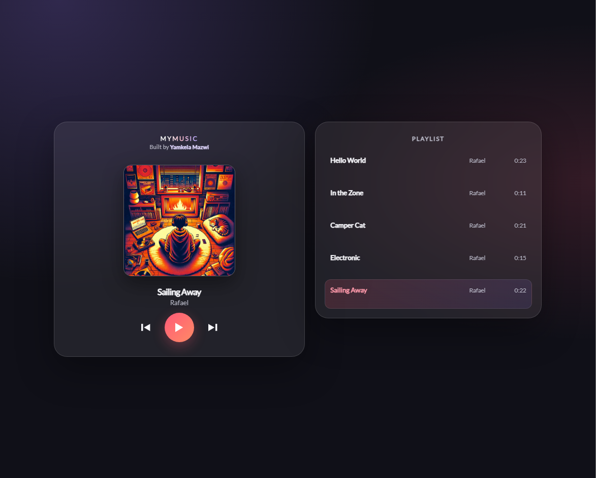

# 🎵 MYMUSIC

[](https://yamkelamazwi.github.io/MusicPlayer/)
[](https://github.com/yamkelamazwi/MusicPlayer)


MYMUSIC is a responsive, browser-based music player created as part of my front-end development practice. It features a polished glass-style interface, album artwork, a selectable playlist, and functional audio controls.

## 📸 Preview



> The screenshot is the app's finished desktop view, with the music player and playlist displayed side by side.

## 🚀 Live Project

- **Live app:** [yamkelamazwi.github.io/MusicPlayer](https://yamkelamazwi.github.io/MusicPlayer/)
- **GitHub repository:** [yamkelamazwi/MusicPlayer](https://github.com/yamkelamazwi/MusicPlayer)

## ✨ Features

- Play and pause the selected audio track
- Previous and next track controls
- Five-song playlist
- Active track highlighting
- Dynamic song title and artist display
- Responsive desktop and mobile layout
- Accessible control labels and keyboard focus states
- Reduced-motion support
- Dark glassmorphism-inspired visual design

## 🛠️ Built With

- **HTML5** — page structure and SVG icons
- **CSS3** — responsive layout, gradients, glass styling, and media queries
- **Vanilla JavaScript** — audio playback, playlist state, controls, and icon updates
- **freeCodeCamp Music Player audio assets** — demonstration tracks and artwork
- **GitHub Pages** — project hosting

## ▶️ How It Works

1. Open the [live app](https://yamkelamazwi.github.io/MusicPlayer/).
2. Select any track from the playlist or use the central play button.
3. Use the previous and next controls to move through the playlist.
4. The central button changes between the play and pause symbols according to the audio state.

## 🧩 Development Pain Points and Edge Cases

### Play/pause icon mismatch

The original layout used separate play and pause SVG elements, while the JavaScript and CSS sometimes toggled the icon state differently. This caused both icons to remain visible or prevented the pause icon from updating.

**Resolution:**

- Use one play/pause control button.
- Keep only one SVG glyph at a time.
- Toggle the `hidden` attribute in JavaScript.
- Use CSS rules that make hidden SVG elements remain hidden.
- Listen to the audio element's `play`, `pause`, and `ended` events for state synchronization.

### Audio playback and browser restrictions

Browsers can block media playback when an action is not initiated by the user. Audio errors can also occur while a remote track is loading or unavailable.

**Resolution:**

- Start playback from click events.
- Catch rejected `audio.play()` promises.
- Update the button back to the play state when playback fails.
- Keep the current track state separate from browser playback state.

### Track state and navigation

The player needed to handle three situations correctly: no track selected, playback paused, and the final track reached.

**Resolution:**

- Store the current song and resume time in `userData`.
- Resume at the stored time when playback resumes.
- Reset the display and icon when there is no next track.
- Guard previous and next navigation when no current song exists.

### Responsive layout

The side-by-side desktop layout had to collapse cleanly on smaller screens without overflowing the viewport or compressing playlist text.

**Resolution:**

- Use a centered, full-width container.
- Apply `min-width: 0` to flex and grid children.
- Add horizontal overflow protection.
- Use text ellipsis for song titles and artist names.
- Add dedicated small-screen and desktop media queries.

### Icon alignment and SVG sizing

Mixed SVG dimensions and the browser's handling of the `hidden` attribute could create alignment or visibility inconsistencies.

**Resolution:**

- Give the control button a fixed size.
- Center icons with CSS grid.
- Apply a consistent SVG width and height.
- Force hidden SVG icons to `display: none`.

### Deployment and cached assets

A deployed GitHub Pages page can continue to show older HTML, CSS, or JavaScript while browser or CDN caches remain active.

**Resolution:**

- Use hard-refresh or cache-bypass tools during testing.
- Inspect the Network tab to confirm the deployed files and request status.
- Verify the GitHub Pages source branch and update status.

## 🧪 Running Locally

```bash
# Clone the repository
git clone https://github.com/yamkelamazwi/MusicPlayer.git

# Enter the project directory
cd MusicPlayer

# Open index.html directly, or serve the directory locally
python3 -m http.server 5500
```

Then visit:

```text
http://localhost:5500
```

## 📁 Project Structure

```text
MusicPlayer/
├── index.html
├── styles.css
├── script.js
├── screenshot.png
└── README.md
```

## 👤 Author

**Yamkela Mazwi**

- GitHub: [@yamkelamazwi](https://github.com/yamkelamazwi)
- Live Project: [MYMUSIC](https://yamkelamazwi.github.io/MusicPlayer/)
